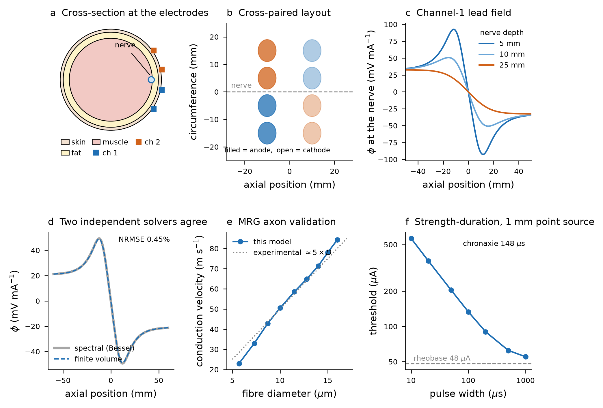
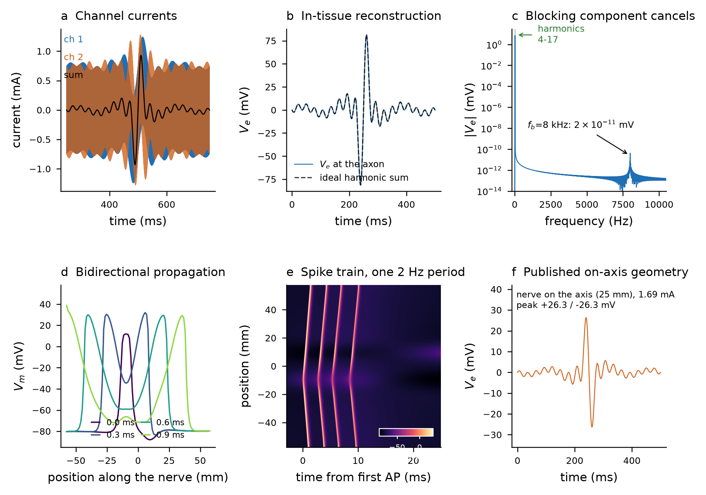
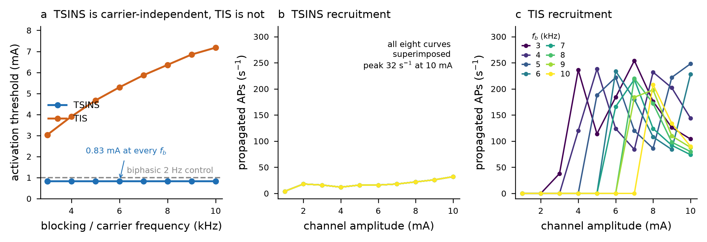
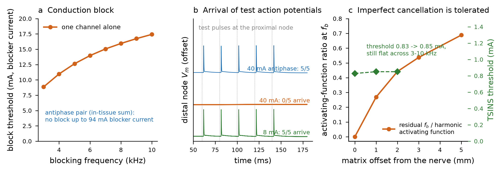
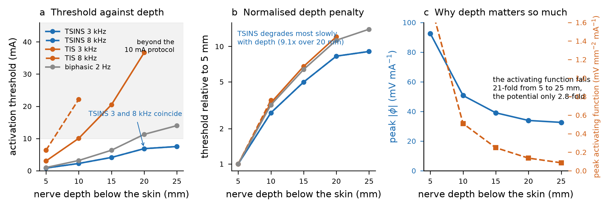

# TSINS vs TIS — three-layer forearm model with an MRG axon

[](https://colab.research.google.com/github/ROsorioL/tsins-model/blob/main/TSINS_model.ipynb)

A verification model for **Transformed Synthesised Interferential Nerve Stimulation** (TSINS)
(Osorio, Edmondson, Sáez, Saavedra, Aqueveque, Poulton, Andrews & Jarvis), built to compare
TSINS against temporal interference stimulation (TIS) and a rectangular biphasic control on
three questions:

1. **Action potential generation** — threshold and firing pattern of a myelinated motor axon.
2. **Kilohertz blocking** — whether the antiphase blocking components really cancel at the
   nerve, and whether a single channel can block conduction.
3. **Depth effect** — how all of this changes as the nerve is moved from 5 mm below the skin
   to the cylinder axis at 25 mm.

Everything runs from one notebook, `TSINS_model.ipynb`, which also contains two interactive
explorers (waveform/depth/fibre sweep and a live conduction-block test).

---

## Run it in Google Colab

Click the badge above, or open
<https://colab.research.google.com/github/ROsorioL/tsins-model/blob/main/TSINS_model.ipynb>.

The notebook's **first code cell is a Colab bootstrap**: it clones this repository into
`/content/tsins-model`, `cd`s into it (the model reads its `.npz` / `.csv` files from the working
directory), installs `pyamg` — the one dependency Colab does not ship — and enables the
custom widget manager so the `ipywidgets` sliders in section 4 render. The same cell is a
no-op when the notebook is run locally, so there is a single notebook for both environments.

A free CPU runtime is enough; there is no GPU code. The first `numba`-compiled simulation
costs about 20 s of JIT, after which a 0.5 s simulated period takes a few seconds.

## Run it locally

```bash
git clone https://github.com/ROsorioL/tsins-model.git
cd tsins-model
python -m venv .venv && source .venv/bin/activate    # Windows: .venv\Scripts\activate
pip install -r requirements.txt
jupyter lab TSINS_model.ipynb
```

Python ≥ 3.11. Tested on Python 3.11.18 with numpy 2.4.6, scipy 1.17.1, numba 0.68.1,
pyamg 5.4.1, pandas 3.1.1, ipywidgets 8.1.9 and matplotlib 3.11.2. Run the notebook **from the repository root** — `tsins_model/` is imported by
relative path and the lead fields and result tables are read from the working directory.

---

## Repository layout

```
TSINS_model.ipynb        the model, start to finish (26 cells, 6 sections)
tsins_model/             the simulation package  -> tsins_model/README.md
  tissue.py              Gabriel 4-Cole-Cole tissue conductivities
  volume.py              3-layer cylindrical finite-volume volume conductor
  spectral.py            semi-analytic layered-cylinder reference solution
  numerics.py            cubic spline, trilinear interpolation, threshold search
  mrg.py                 McIntyre-Richardson-Grill double-cable axon (numba)
  waveforms.py           TSINS / TIS / biphasic synthesis
  coupling.py            lead fields -> axon
  sweep.py               parameter sweeps
  blocktest.py           kHz conduction-block protocol
leadfields.npz           aligned matrix, 5 depths x 2 bands x 2 channels
leadfields_offset{1,2,3,5}.npz   matrix offset off the nerve, 5 mm depth
*.csv                    precomputed results the notebook displays
figures/                 paper figures and their trace data -> figures/README.md
tables/                  result tables in publication form  -> tables/README.md
README.txt               the original package README, kept verbatim
```

The `.csv` and `.npz` files are committed so that the notebook renders every result without
re-running the sweeps. Rebuilding the lead fields from the finite-volume model takes about
20 s per solve; set `RESOLVE = True` in the notebook cell under section 1 to do it.

---

## What this model adds to the published one

| | published model | this model |
|---|---|---|
| volume conductor | single isotropic muscle cylinder, COMSOL | three layers (skin / fat / muscle) + nerve inclusion + electrode gel, finite volume, verified against a semi-analytic Bessel solution |
| axon | Hodgkin–Huxley | McIntyre–Richardson–Grill double cable, full myelin and periaxonal space |
| nerve position | on the cylinder axis (25 mm deep) | swept 5–25 mm; 5 mm is the ulnar nerve at the wrist |
| conductivity | single value at 8 kHz | separate Gabriel 4-Cole-Cole values for the harmonic band (20 Hz) and the kHz band |

## Waveform definition (paper Eqs. 1–6)

```
ch1(t) = g [ sum_{n=n0}^{n0+K-1} An sin(2 pi n f0 t + phi_n) + Ab sin(2 pi fb t)      ]
ch2(t) = g [ sum_{n=n0+K}^{n0+2K-1} An sin(2 pi n f0 t + phi_n) + Ab sin(2 pi fb t + pi) ]
```

with `f0 = 2 Hz`, `n0 = 4`, `K = 7`, `An = 1`, `phi_n = 0`, `kappa = 10` (so `Ab = 10`) and
`g = 1/16`. Because `sin(theta + pi) = -sin(theta)`, the blocking components cancel wherever
the two fields add linearly, leaving `TSINS(t) = (1/16) sum_{n=4}^{17} sin(2 pi n f0 t)`.

**TIS** is defined here as `fb` on channel 1 and `fb + 2 Hz` on channel 2, so the beat
frequency matches the TSINS fundamental. **Biphasic control**: 0.25 ms per phase at 2 Hz,
delivered in phase on both channels (as in Fig. 8 of the paper).

---

## Results

### Model and verification



### Waveform reconstruction in tissue



TSINS threshold is **0.83 mA at every blocking frequency from 3 to 10 kHz**; TIS rises from
3.03 mA at 3 kHz to 7.18 mA at 10 kHz (2.4-fold) — the waveform × frequency interaction the
paper reports, obtained here from first principles.



### Kilohertz blocking

A **single channel's** kilohertz component blocks conduction at 8.9 mA (3 kHz) rising to
17.4 mA (10 kHz) of blocker current. The **antiphase pair** produced no block at any
amplitude tested (up to 94 mA of blocker current), because the two components cancel where
the fields overlap. Misaligning the electrode matrix by 1–5 mm leaves 21–62 % of one
channel's field at `fb` at the nerve, yet the TSINS threshold only moves from 0.83 to
0.85 mA and stays flat across 3–10 kHz: **TSINS does not require perfect cancellation**.



### Depth

Over 5 → 25 mm the TSINS threshold rises 9.1-fold (0.83 → 7.51 mA) and the biphasic control
14-fold (1.00 → 14.0 mA), while TIS at 3 kHz rises 12-fold by 20 mm (3.03 → 36.7 mA) and TIS
at 8 kHz exceeds 40 mA beyond 10 mm. TSINS is the only one of the three that still activates
the axon within the 10 mA protocol range at every depth tested (7.51 mA at 25 mm). It also
has the lowest threshold of the three at every depth, and its margin over the biphasic
control widens with depth — the TSINS / biphasic threshold ratio falls from 0.83 at 5 mm to
0.54 at 25 mm. Thresholds are searched up to a 40 mA ceiling (`sweep.threshold(hi=40.0)`);
"beyond 40 mA" means no threshold was found below it.



---

## Verification summary

**Against the paper**

| quantity | this model | paper |
|---|---|---|
| blocking component at the nerve (aligned electrodes) | 2 × 10⁻¹¹ mV | "no 8 kHz component was visible" |
| peak \|Ve\| at the on-axis nerve, TSINS | 41 mV at 1.69 mA (symmetric, so +41 / −41) | +41 / −32 mV |
| main lobe of the target waveform | t = 0.4897 s | "main lobe at t = 0.5 s" |
| charge per 1 s at 10 mA, TSINS / TIS | 0.636 | 0.63 |
| charge, TSINS / TIS / biphasic | 8.10 / 12.73 / 0.0200 mC | 6.96 / 11.05 / 0.019 mC |
| TSINS carrier dependence of recruitment | none (0.83 mA at 3–10 kHz) | "near-identical recruitment curves" |
| TIS carrier dependence | threshold × 2.4 from 3 to 10 kHz | force falls steeply with carrier |

**Independently**

| component | check |
|---|---|
| volume conductor | 0.45 % NRMSE vs a semi-analytic Bessel solution; grid-converged to 0.15 %; exact current conservation; channel resistance 1.05–1.09 kΩ |
| MRG axon | CV 50.5 m/s at 10 µm (MRG 2002 ≈ 52); CV/D 4.0–5.3; AP 110 mV, 0.33 ms half-width, DAP present; chronaxie 148 µs, rheobase 48 µA |
| time step | 2.5 µs converged to < 1 % against 0.5 µs for a 10 kHz carrier |

## Limitations

1. **One fibre, not a population.** The model simulates a single 10 µm fibre at one position,
   so it predicts thresholds and firing patterns, not force.
2. **Exact symmetry.** With the aligned cross-paired layout the two channels are electrically
   indistinguishable at the nerve, so blocking cancellation is exact; the real asymmetry is
   reproduced only by offsetting the matrix.
3. **Skin conductivity** is set to a prepared/wet value of 0.10 S/m rather than the Gabriel
   dry-skin value, which is incompatible with the DS5 compliance voltage
   (parameter in `tissue.default_sigmas`).
4. **Quasi-static, linear, isotropic tissue.** No muscle anisotropy, no electrode–skin
   interface impedance, no temperature or accommodation effects, no cutaneous afferents.
5. The nerve is a straight cylinder of uniform conductivity; fascicular structure and
   perineurium are not represented.

## References

* McIntyre CC, Richardson AG, Grill WM (2002). Modeling the excitability of mammalian nerve
  fibers: influence of afterpotentials on the recovery cycle. *J Neurophysiol* 87:995–1006.
* Gabriel S, Lau RW, Gabriel C (1996). The dielectric properties of biological tissues.
  *Phys Med Biol* 41:2251–2293 (IT'IS 4-Cole-Cole parameterisation).
* Osorio R, Edmondson L, Sáez M, Saavedra N, Aqueveque P, Poulton A, Andrews B, Jarvis S.
  Transformed Synthesised Interferential Nerve Stimulation.

## License

MIT — see [LICENSE](LICENSE).
